# Weather Trend Forecasting: Report

Akhilesh Kanoj, PM Accelerator Data Science Intern assessment

## About PM Accelerator

**Product Manager Accelerator**
Boston, MA, founded 2020
pmaccelerator.io | linkedin.com/school/pmaccelerator

The Product Manager Accelerator Program supports product managers through every stage of their careers, from students looking for their first PM job to directors moving into leadership roles, and has helped hundreds of people reach their career goals. Its programs include:

- PMA Pro: end-to-end PM job hunting, with FAANG-level PM skills, unlimited mock interviews and referrals through its alumni network
- AI PM Bootcamp: build a real AI product with a team of AI engineers, data scientists and designers, and launch it to real users
- PMA Power Skills: sharpens PM, leadership and executive presentation skills for working PMs
- PMA Leader: helps PMs get promoted to director and product executive levels
- 1:1 Resume Review: PM resume rewrites with an interview guarantee

It also publishes hundreds of free PM training videos and courses on YouTube.

## The data

The Kaggle Global Weather Repository has one weather snapshot per capital city per day. The file I used has
170,928 rows and 41 columns, from 16 May 2024 to 13 October 2026 (about 2.4 years). It covers temperature,
wind, pressure, precipitation, humidity, cloud, visibility, UV and six air quality measures.

Every number in this report comes from the executed notebooks in `notebooks/`. Full metric tables are in
`reports/metrics/`.

## 1. Data cleaning (notebook 01)

- **Locations.** I kept the 185 country and location pairs with at least 500 daily rows (178 countries).
  The 101 pairs I dropped (9,180 rows) are mostly the same capitals with the country name written in another
  language, or wrong matches. They cannot form a time series.
- **Duplicates.** 187 rows where a location had two snapshots on the same day. I kept the first.
- **Unit copies.** I dropped the 7 imperial columns after checking they match the metric ones.
- **Placeholders.** -9999 in CO and SO2 and negative PM10 values (4 values) were set to missing.
- **Impossible values** were set to missing, not clipped: 79.3 C in Suva, five wind readings up to 2,963 km/h,
  and pressure readings of 3,000, 3,006 and 1,080 mb.
- **Pressure change in July 2026.** Between 25 and 31 July 2026 some cities reported station pressure instead of
  sea-level pressure (for example 771 mb in Addis Ababa). I removed values below 950 mb (36) and values more than
  15 mb below the same city's median of the previous 7 days in that week (39 more). The same rule fires about
  4 times per week in normal summer weeks, so most of the 39 are real errors.
- **A corrupted day.** On 17 August 2026 about half of all locations jump by more than 8 C for one day, with
  labels like "Blizzard" in London in August. I removed all 184 rows of that day.
- **Gaps** from cleaning (94 values) were filled with the previous day's value of the same location, at most
  3 days back. This only uses the past.
- **Result:** 161,377 rows.

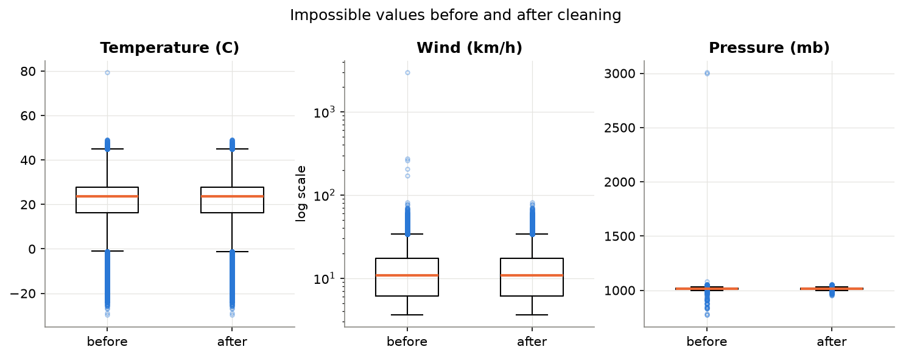

**Snapshot time drift.** The time of the daily snapshot moved about 6 hours earlier in the local day between 2024
and 2026 (London from about 13:00 to 07:00). Comparing years therefore also compares different times of day.
I kept the local hour as a column and used it as a model feature.

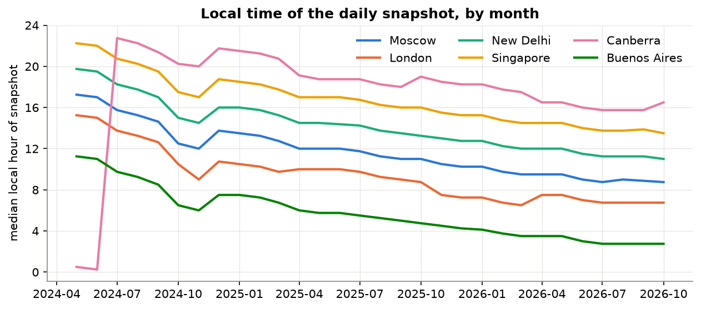

**Normalization.** The saved file keeps real units. In the models, continuous inputs are standardized, with a log
first for precipitation and air quality. The scaler is always fit on the training rows only.

## 2. Exploratory analysis (notebook 02)

- Mean temperature falls with distance from the equator (correlation -0.76 with absolute latitude), and the
  seasonal cycle grows with it (0.85). The warmest capital on average is Doha (33.0 C), the coldest Ulaanbaatar (6.0 C).
- A global average hides the seasons. The warmest minus coldest month is 16.6 C in the north and 7.0 C in the
  south, in opposite directions. 144 of 185 locations are northern, so the all-locations average copies the north.
  This is why I forecast individual cities.

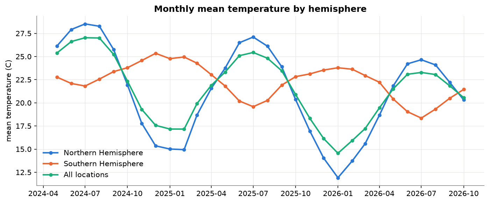

- The July mean fell every year in both hemispheres (north 28.5, 27.1, 24.7 C). That is what earlier snapshots
  in the day would produce, so I do not read it as a climate trend.
- 32.5% of snapshots report precipitation. The amount at snapshot time is small (median 0.10 mm when it rains).
  New Delhi's monsoon is clear: 31 to 47% of snapshots are wet in July to September, 0 to 7% from October to May.
- Temperature and feels-like (0.97) and wind and gust (0.91) are near copies of each other.

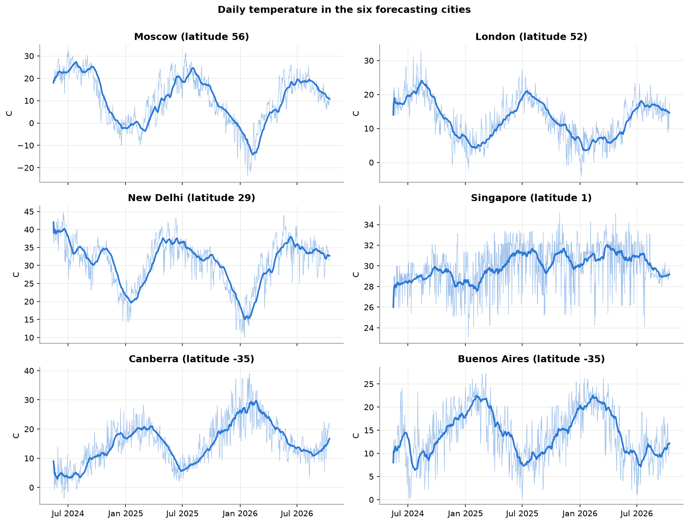

## 3. Forecasting (notebooks 03 and 04)

**Task.** Tomorrow's temperature in six cities from different climates: Moscow, London, New Delhi, Singapore,
Canberra and Buenos Aires. One model per city.

**Features** (all known the day before): temperature 1, 2, 3 and 7 days earlier, 7 and 30 day means, Fourier
terms for the time of year, yesterday's humidity, cloud, wind, precipitation, pressure and pressure change, and
yesterday's snapshot hour. A test checks that every lag equals the real value of the previous day.

**Splits** (chronological, no shuffling): train to 16 April 2026, validation 17 April to 15 July 2026, test
16 July to 13 October 2026 (89 days per city). Settings and ensemble weights were chosen on validation. The models
were then refit on train and validation and used once on test, one day ahead.

**Models.** Two baselines (naive: yesterday's value; seasonal naive: same day last year), Ridge, Random Forest
(300 trees), Gradient Boosting (300 trees), SARIMAX with Fourier terms (a 365-day seasonal ARIMA is not possible
with 2.4 years of data), an equal-weight ensemble and a weighted ensemble (weights fit on validation).

**Test MAE (C)**

| City | Naive | Seasonal naive | Ridge | Random Forest | Gradient Boosting | SARIMAX | Ensemble (avg) | Ensemble (weighted) |
|---|---|---|---|---|---|---|---|---|
| Moscow | 1.96 | 3.87 | 1.77 | 1.83 | 1.77 | 1.88 | 1.77 | 1.77 |
| London | 2.11 | 2.78 | 1.89 | 1.91 | 1.86 | 1.88 | 1.85 | 1.88 |
| New Delhi | 1.65 | 3.61 | 1.77 | 1.71 | 1.83 | 1.79 | 1.75 | 1.74 |
| Singapore | 0.81 | 2.04 | 1.16 | 0.83 | 0.86 | 1.45 | 1.04 | 0.88 |
| Canberra | 2.40 | 3.65 | 2.13 | 2.38 | 2.22 | 2.39 | 2.19 | 2.11 |
| Buenos Aires | 2.29 | 3.79 | 2.36 | 2.07 | 2.08 | 2.32 | 2.13 | 2.17 |
| **Average** | 1.87 | 3.29 | 1.84 | 1.79 | 1.77 | 1.95 | 1.79 | 1.76 |

Average over the six cities for the other metrics:

| Metric | Naive | Seasonal naive | Ridge | Random Forest | Gradient Boosting | SARIMAX | Ensemble (avg) | Ensemble (weighted) |
|---|---|---|---|---|---|---|---|---|
| RMSE (C) | 2.55 | 4.09 | 2.37 | 2.33 | 2.31 | 2.44 | 2.30 | 2.29 |
| sMAPE (%) | 12.79 | 21.21 | 12.27 | 12.02 | 11.83 | 12.76 | 11.84 | 11.76 |
| R2 | 0.17 | -1.10 | 0.25 | 0.31 | 0.31 | 0.17 | 0.30 | 0.32 |

What this shows:
- The weighted ensemble has the lowest average MAE, 1.76 C against 1.87 C for naive (about 6% better).
  It beats naive in Moscow, London, Canberra and Buenos Aires.
- **No model beats naive in New Delhi or Singapore.** In Singapore the readings become almost constant from
  September 2026 (monthly standard deviation 0.3 to 0.5 C against about 2 C before), so "same as yesterday" is
  nearly perfect. On validation the models were better than naive there (1.53 vs 2.10 C).
- SARIMAX is worse than naive on average (1.95 C), mainly because of Singapore.
- Every model beats the seasonal naive baseline in every city.
- The largest gain over naive is 12.4%. I treated anything above 30% as a sign of leakage; nothing came close.
- R2 is low because within one 90-day window most of the variation left is day-to-day weather.

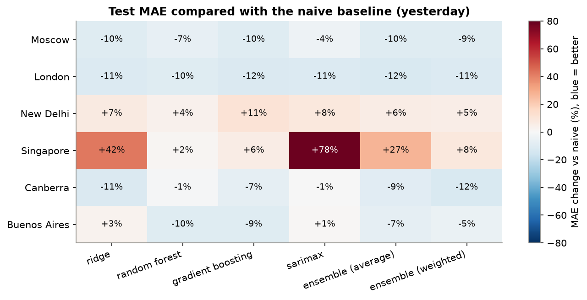

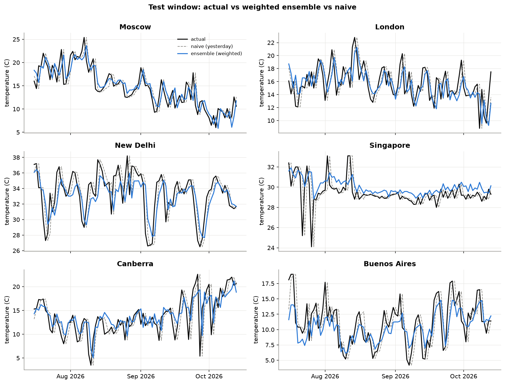

**Feature importance, three ways.** Random Forest impurity, permutation importance on the validation window and
mutual information all rank yesterday's temperature first, then yesterday's pressure and humidity. The snapshot
hour and the seasonal terms matter little for the change from one day to the next.

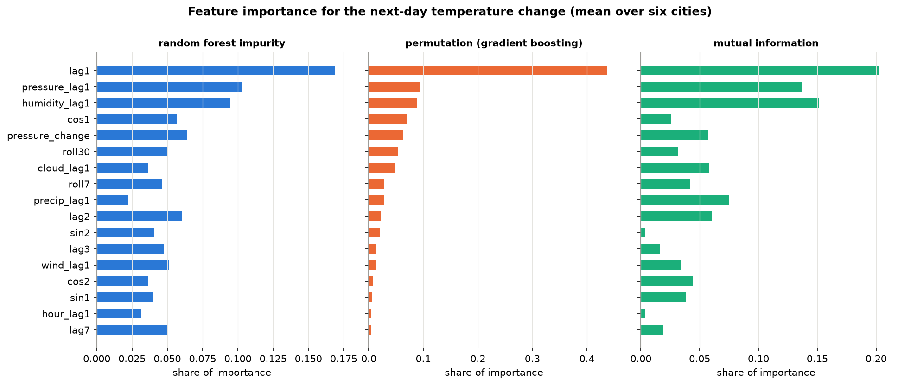

## 4. Anomaly detection (notebook 05)

- **MAD z-score** on the temperature minus its 31-day centred median, per location, with |z| > 3.5 and at least
  3 C: 2,357 anomalies (1.46%). Cold ones (1,644) are more common than warm ones (713), often tropical rain days.
- **Isolation Forest** on seven weather variables, standardized per location: 1,614 anomalies (1.00%, set by
  the contamination parameter).
- The methods overlap little (473 readings flagged by both, 13.5%). Isolation Forest mostly finds days with heavy
  rain and poor visibility, which a temperature-only method cannot see.
- The first day of data has the most flags (18.6% of locations), because it was recorded at 08:45 UTC while the
  following days were recorded around 16:00 UTC. No other day goes above 8.1%.
- PM2.5 outliers (above 194.8 ug/m3 on a log box plot rule): 881 readings (0.55%), concentrated in Riyadh (22.4%
  of days), Jakarta (20.2%) and Beijing (14.8%). These are pollution episodes, not errors.

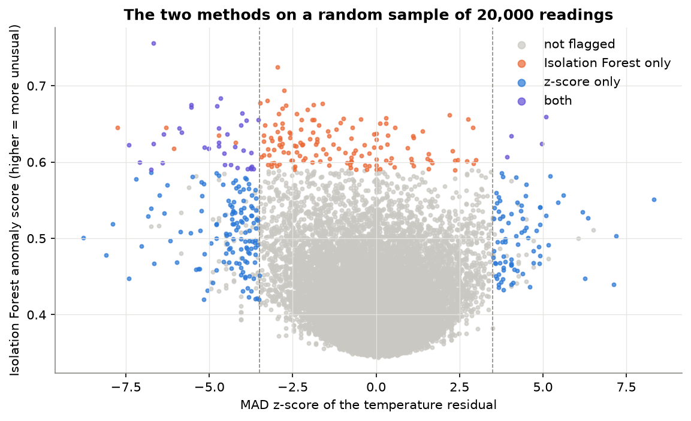

## 5. Climate, air quality and spatial patterns (notebook 06)

**Climate by region.** Europe has the lowest mean temperature (14.1 C) and the largest seasonal range (21.6 C).
Tropical regions have small ranges (Oceania 4.1 C). By latitude band the range grows from about 2 C near the
equator to 21.8 C at 30 to 45 N, and the southern bands peak in December to February.

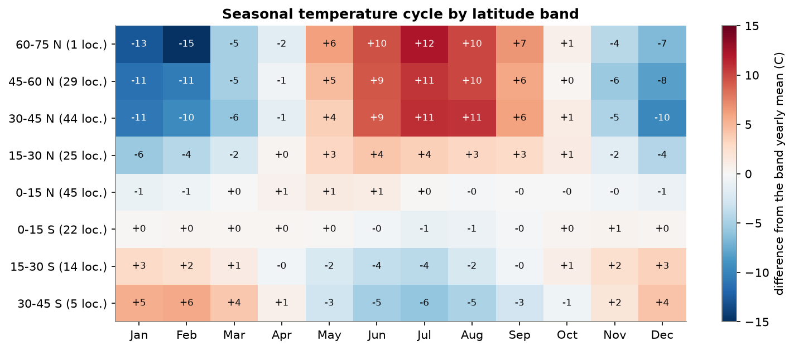

**Air quality vs weather.** I compared correlations pooled over all cities with correlations inside each city
(median over 185 locations), because pooled numbers mix city differences with day-to-day effects.
- Wind goes with lower NO2 (-0.33, same sign in 96% of locations), SO2 (-0.24) and PM2.5 (-0.17). PM2.5 is not
  a straight line though: it is lowest at 15 to 20 km/h and higher again at 30 to 40 km/h.
- Rain goes with fewer particles (PM10 -0.16, PM2.5 -0.15).
- Ozone rises with UV (0.33) and temperature (0.33) and falls with humidity (-0.37).
- All of these are weak to moderate. Weather explains only part of the day-to-day change in air quality.

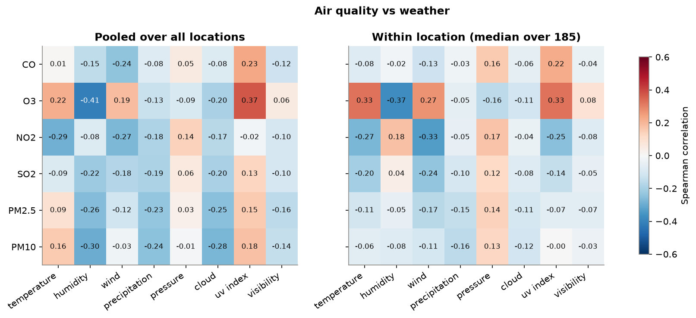

**Spatial patterns.** The highest median PM2.5 is in Riyadh (100.1 ug/m3), Jakarta (99.4), Beijing (95.6) and
New Delhi (91.1). The lowest is on Pacific islands such as Honiara (2.4). In Asia 15.4% of readings are rated
unhealthy or worse on the US EPA index; in Oceania none. Day-to-day temperature anomalies of two capitals are
correlated at 0.59 when they are less than 250 km apart, 0.32 at 500 to 1,000 km and about 0 beyond 2,000 km.

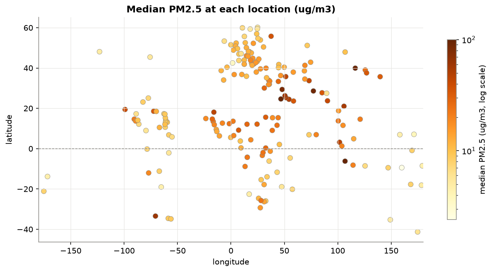

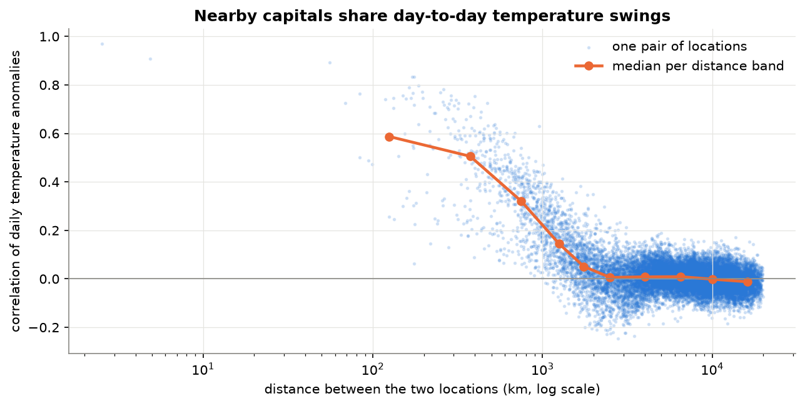

## Key findings

1. Latitude explains most of the climate differences: mean temperature (correlation -0.76) and seasonal range (0.85).
2. A global average temperature is misleading because the hemispheres cancel out; city-level forecasts are more meaningful.
3. One day ahead, "same as yesterday" is hard to beat. The best method (weighted ensemble) is about 6% better on
   average and wins in four of six cities.
4. Yesterday's temperature, pressure and humidity are the most useful inputs.
5. Wind and rain go with cleaner air, while ozone follows sunlight.
6. Weather anomalies are regional: correlation between cities fades to zero beyond about 2,000 km.

## Limitations

- **Short history.** About 2.4 years gives two yearly cycles. Seasonal models with a 365-day period are not possible.
- **One test season.** The test window is 89 days in northern late summer and southern late winter. Results in
  other seasons may differ.
- **Snapshot timing.** One reading per day at a time that drifted by about 6 hours. It mixes weather with the time
  of day, and it makes year-to-year trends unreliable.
- **Data source changes.** The July 2026 pressure switch, the corrupted 17 August 2026, and the flat readings in
  Singapore and other tropical places from September 2026 suggest the source changed during the period.
  The last two are in the test window.
- **Coverage.** One capital per country, so large countries are represented by a single point, and some regions
  (Oceania, South America) have few locations.
- **17 August 2026 was found by looking at the data**, and it falls in the test window. I documented the removal in
  notebook 01. It does not change which model was chosen, since choices were made on validation.
